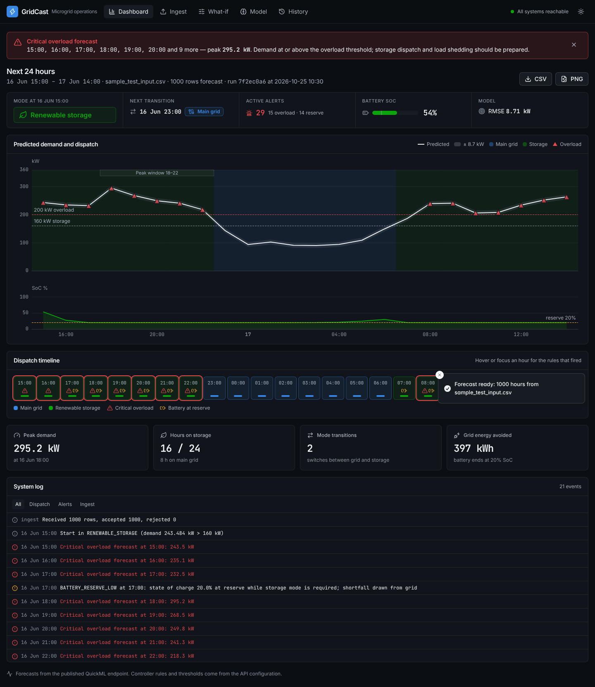
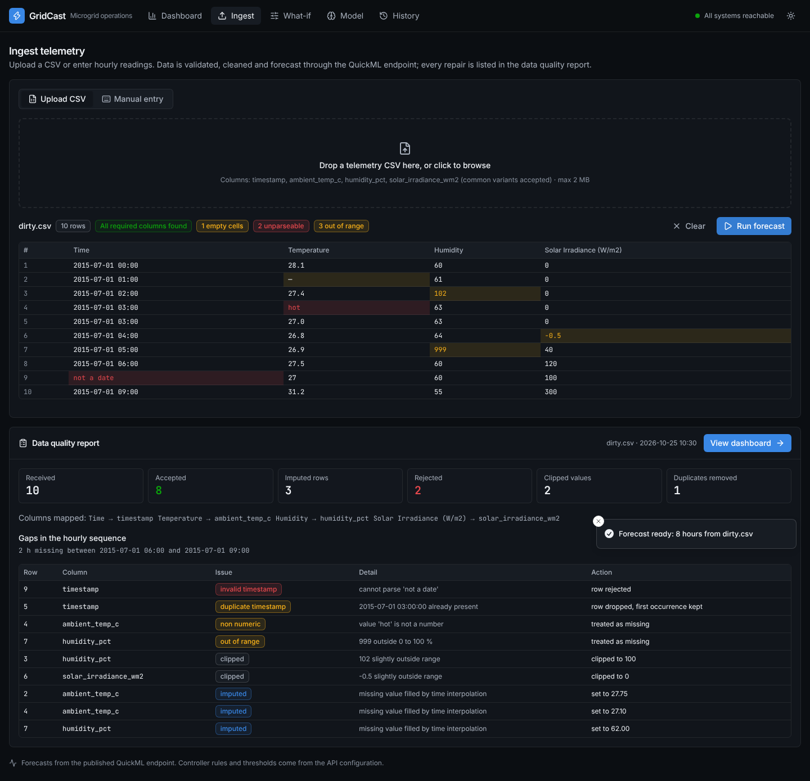
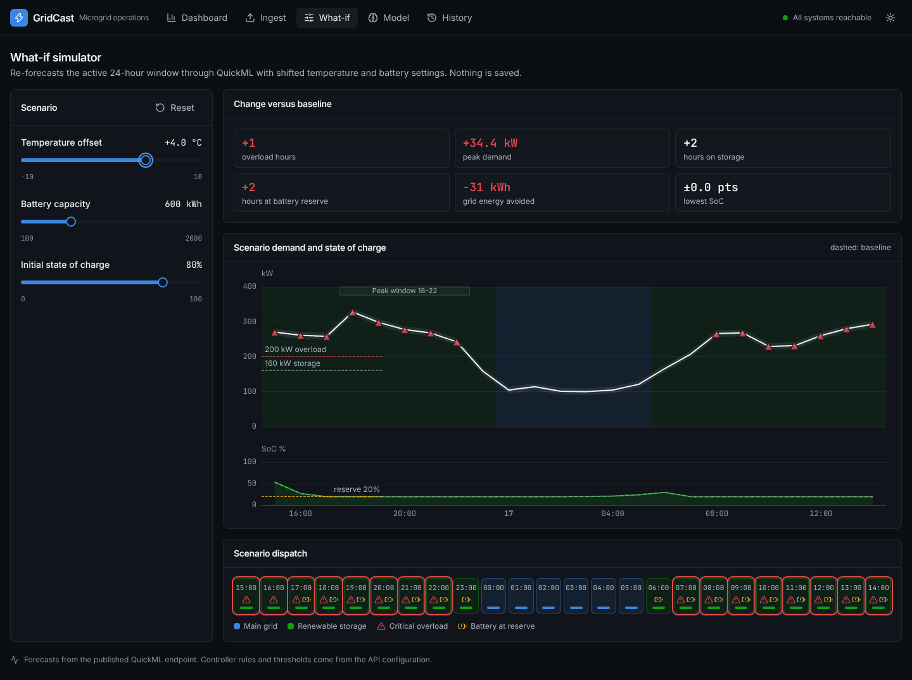
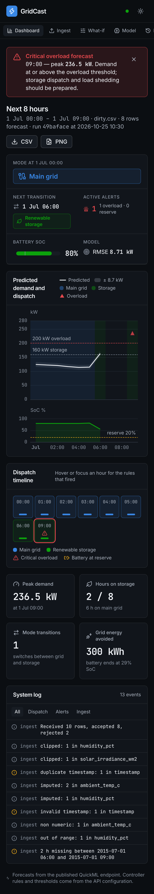
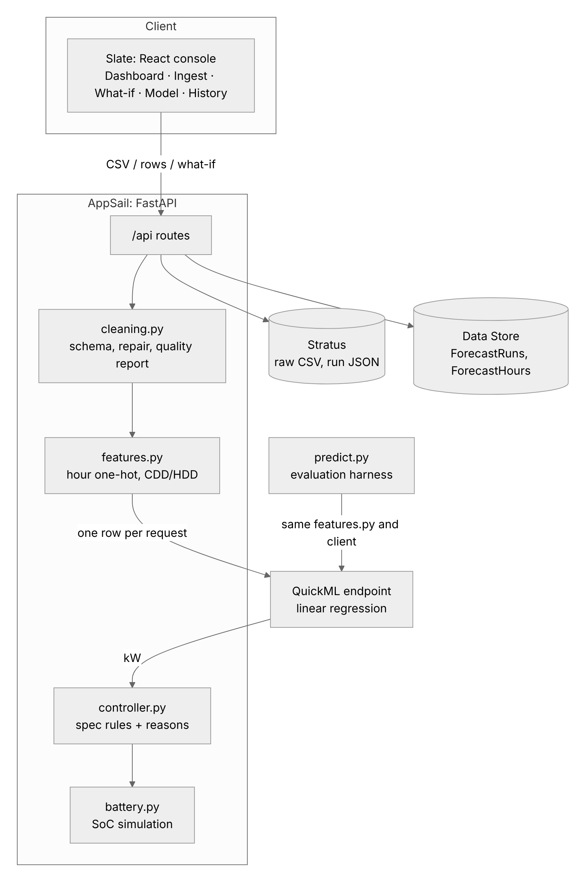

# GridCast: microgrid demand forecasting and grid-transition control

GridCast forecasts hourly microgrid demand for the next 24 hours and decides, hour by hour, whether the site
should run on the main grid or on renewable battery storage. It raises critical-overload alerts, simulates
the battery's state of charge, and shows everything in an operations console. The model is a linear
regression on hour-of-day and cooling/heating degree-days, published on Zoho Catalyst QuickML. It reaches a
time-ordered cross-validation RMSE of **8.71 kW**, against **13.9 kW** for gradient boosting and **46 kW**
for a raw-weather baseline, because it keeps working as the weather moves into the hotter summer months the
evaluation covers.

**Live app:** _to be added after Catalyst deployment_ · **API docs:** `<appsail-url>/docs`



| Ingest and data-quality report | What-if simulator | Mobile |
|---|---|---|
|  |  |  |

## Architecture



| Module | Catalyst service | Code |
|---|---|---|
| Dashboard | Slate | `frontend/` (Vite, React, TypeScript, Tailwind, Radix, ECharts, TanStack Query) |
| API, cleaning, controller, battery simulation | AppSail | `backend/app/` (FastAPI, pydantic) |
| Demand model | QuickML endpoint | trained on `ml/quickml_train.csv` |
| Raw uploads, full run documents | Stratus | `backend/app/storage.py` |
| Run index, per-hour signals | Data Store | `backend/app/storage.py` |

There is exactly one feature pipeline, `backend/app/features.py`. Three things use it: the training export
(`ml/train.py`), the API, and `predict.py`. A test (`test_quickml_export_matches_pipeline`) rebuilds the
QuickML training table from raw data and checks that it is identical to the export, so training and
inference cannot drift apart.

## Model

Full analysis: [`ml/README.md`](ml/README.md). The same data is served by `GET /api/model` and shown on the
console's Model page.

| Model | CV RMSE (5 time-ordered folds) | Holdout RMSE (last 20%) |
|---|---:|---:|
| Linear, raw weather only (baseline) | 45.99 | 54.19 |
| LightGBM, raw weather + hour + weekday | 13.93 | 14.51 |
| LightGBM, engineered features | 16.19 | 24.97 |
| **Linear, hour one-hot + CDD/HDD (selected)** | **8.71** | **8.30** |
| Ridge, same features | 8.71 | 8.30 |
| Linear + LightGBM on residuals | 8.89 | 8.40 |

QuickML (Linear Regression on `ml/quickml_train.csv`, QuickML's own evaluation split): **RMSE 8.42 kW, MAE 6.70 kW, R² 0.971**. Live holdout figure from
`python ml/holdout_check.py`: _to be recorded against the published endpoint._ Against the local reference
endpoint it gives 8.25 kW.

### Design decisions

- **Linear with hour of day beats trees here.** Demand is a step function of the hour (about 92 kW
  overnight, 160–185 kW in the daytime, 205–220 kW at 18–22). On top of that sits a cooling load of
  8.6 kW per °C above 24 °C, and that slope is the same at every hour. The evaluation period is about
  11 °C warmer on average than the training period. Tree ensembles cannot predict beyond the hottest
  temperature they were trained on, so their error grows fold by fold (9.2 → 17.6 kW). The linear model
  stays between 8.3 and 9.6 kW.
- **The knees are learned, not assumed.** The cooling and heating base temperatures are grid-searched under
  TimeSeriesSplit on the first 80% of the data. Cooling lands on 24.0 °C.
- **Raw temperature is left out of the features.** Next to CDD/HDD it is collinear and makes the knee
  location unidentifiable. Without it, the knee is stable and the score is unchanged.
- **Optional terms were tested and rejected:** CDD × daytime (8.89), CDD² (10.02, which extrapolates
  badly), and a weekend flag (8.72).

## Transition controller

`backend/app/controller.py` is a pure function: `evaluate(demand_kw, hour) -> Signal(mode, overload, reasons)`.

| Condition | Output |
|---|---|
| demand > 160 kW **or** 18 ≤ hour ≤ 22 | `RENEWABLE_STORAGE` |
| otherwise | `MAIN_GRID` |
| demand ≥ 200 kW (independent of mode) | critical overload alert |

Each signal carries the rules that fired, for example `demand 172.4 kW > 160 kW` or
`hour 19:00 in peak window 18:00-22:00`. The thresholds and the window come from configuration
(`backend/app/config.py`, overridable by environment variable). The defaults are the specification values.

There are 27 tests for the controller, with 100% branch coverage. They cover demand of 160.0, 160.01,
199.99 and 200.0 kW; hours 17, 18, 22 and 23; the peak window with low demand; high demand outside the
window; overloads inside and outside the window; and invalid inputs. An API test also re-checks every
hour of the 1,000-row sample run against the rules.

**Battery simulation** (`battery.py`) is advisory and never changes the mode the controller chose. In
storage mode the battery serves demand, limited by its discharge rate and reserve, and the grid covers any
shortfall. In grid mode it charges from solar, in proportion to irradiance. Round-trip losses are split
evenly between charging and discharging. When the state of charge sits at the reserve during storage mode,
the simulation raises `BATTERY_RESERVE_LOW`. Each run also reports mode transitions, hours in each mode,
peak demand and its hour, and the grid energy avoided.

## Ingestion and cleaning

`backend/app/cleaning.py` does the following, and records every change in the data-quality report shown in
the UI:

- Accepts common header variants, such as `Temperature`, `rh` or `Solar Irradiance (W/m2)`. If required
  columns are missing, the error names them and lists the columns that were found.
- Parses mixed timestamp formats and time zones, keeping local wall-clock time. It aligns timestamps to the
  hour, sorts the rows, drops duplicate timestamps (keeping the first), and reports gaps in the hourly
  sequence.
- Treats non-numeric values as missing. Values slightly outside physical ranges are clipped: humidity 0–100
  with 5 points of tolerance, irradiance 0–1500 W/m² with 10 W/m² of tolerance. Values far outside the
  range (or temperatures outside −30 to 55 °C) are treated as missing.
- Fills short gaps by time interpolation. A gap is filled only if it spans at most
  `MAX_IMPUTE_GAP_HOURS` (default 3) of real time. Rows in longer gaps are rejected, with the reason.
- If the upload contains `target_demand_kw`, it is kept and scored: the console shows the RMSE against
  those actuals.

Every row is forecast. The dashboard shows the first 24 hours from the earliest timestamp.

## API

| Method | Path | Purpose |
|---|---|---|
| POST | `/api/forecast/upload` | CSV → Stratus → clean → features → QuickML → controller → battery → Data Store |
| POST | `/api/forecast/manual` | 1–24 JSON rows from the form |
| POST | `/api/simulate` | What-if: temperature offset and battery parameters. Baseline and scenario are scored in one prediction pass, and nothing is persisted |
| GET | `/api/runs`, `/api/runs/{id}` | Run history |
| GET | `/api/health` | QuickML and storage reachability, reported separately |
| GET | `/api/config`, `/api/model` | Thresholds and the model card, so the UI hard-codes neither |

Failures are mapped to readable, typed errors. Invalid input returns 422 with the issue list. A QuickML
failure returns 502 marked `retryable`. A missing configuration returns 503. If storage is down, the
forecast is still returned, flagged `persisted: false`.

## Setup

```bash
# Python 3.11+
pip install -r requirements-dev.txt
cp .env.example .env                      # fill in the QuickML endpoint and Zoho credentials

python ml/train.py && python ml/model_card.py && python ml/eda.py   # reproduce the model work
pytest                                    # 157 tests
python test_eval.py                       # starter-kit contract check: prints SUCCESS
python predict.py --input sample_test_input.csv --output predictions.csv

cd backend && python -m app               # API on :8000, docs at /docs
cd frontend && npm ci && npm run dev      # console on :5173, proxies /api to :8000
```

To run without Catalyst credentials, use the local reference endpoint, which serves the same OLS model with
the same request format:

```bash
python ml/local_endpoint.py --port 8765 &
export QUICKML_ENDPOINT_URL=http://127.0.0.1:8765/predict QUICKML_ENDPOINT_KEY=local QUICKML_ACCESS_TOKEN=local
```

Deployment steps for QuickML, Data Store tables, Stratus, AppSail and Slate are in
[`docs/deployment.md`](docs/deployment.md).

### Environment variables

| Variable | Used by | Purpose |
|---|---|---|
| `QUICKML_ENDPOINT_URL` | predict.py, API | `https://api.catalyst.zoho.<dc>/quickml/v1/project/<id>/endpoints/predict` |
| `QUICKML_ENDPOINT_KEY` | predict.py, API | Sent as `X-QUICKML-ENDPOINT-KEY` |
| `ZOHO_CLIENT_ID`, `ZOHO_CLIENT_SECRET`, `ZOHO_REFRESH_TOKEN`, `ZOHO_ACCOUNTS_URL` | predict.py, API | Self-client refresh token; access tokens are minted and renewed automatically |
| `QUICKML_ACCESS_TOKEN` | predict.py, API | Alternative to the refresh-token variables (expires after one hour) |
| `CATALYST_ORG_ID` | predict.py, API | Optional `CATALYST-ORG` header |
| `QUICKML_MAX_WORKERS`, `QUICKML_TIMEOUT_S`, `QUICKML_MAX_RETRIES` | predict.py, API | Concurrency, timeout and retries |
| `STORAGE_BACKEND` | API | `catalyst` in production, `local` (SQLite) in development |
| `STRATUS_BUCKET`, `DATASTORE_RUNS_TABLE`, `DATASTORE_HOURS_TABLE` | API | Catalyst resource names |
| `CORS_ORIGINS` | API | JSON list containing the Slate origin |
| `STORAGE_THRESHOLD_KW`, `OVERLOAD_THRESHOLD_KW`, `PEAK_START_HOUR`, `PEAK_END_HOUR`, `BATTERY_*` | API | Controller and battery configuration |
| `VITE_API_BASE_URL` | frontend build | AppSail URL |

`.env` is gitignored. Only `.env.example` is committed.

## Quality

The CI workflow (`.github/workflows/ci.yml`) runs:

- ruff (lint and format), mypy `--strict`, and pytest with branch coverage. The backend is at 98%, and
  `controller.py` and `battery.py` are at 100%.
- `test_eval.py` against the local reference endpoint.
- The frontend's Prettier check, ESLint, TypeScript check and production build.
